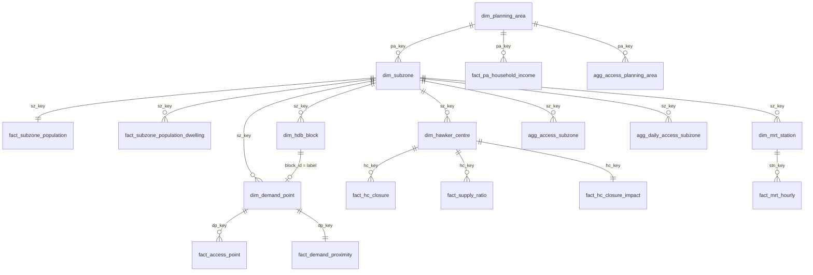

# Mapping the Gap — Hawker Centre Accessibility Data Build (2SFCA)

This repo turns the team's six source files, plus a few public APIs, into one keyed data model. The model measures **how many hawker stalls each resident can reach**, split by **HDB, condominium and landed housing**. It uses the Two-Step Floating Catchment Area (2SFCA) family of methods and tests what happens when centres close for cleaning or renovation.

```
raw files ─┐                                      ┌─ dim_* (conformed dimensions)
           ├─ prep_* ─ build_demand ─ compute_access ─ build_model ─┼─ fact_* / agg_* (2SFCA outputs)
APIs ──────┘   (keys, joins,  (population on    (2SFCA, E2SFCA,   └─ hawker_2sfca.sqlite + data_dictionary.csv
                cleaning)      demand points)    3SFCA, closures)
```

---

## 1. Quick start

```bash
pip install -r requirements.txt            # pandas, numpy, scipy, matplotlib, openpyxl, requests (no GDAL needed)

# optional keys (set once per terminal)
export URA_ACCESS_KEY=xxxx                 # free: https://eservice.ura.gov.sg/maps/api/reg.html  (condo/landed locations)
export DATAGOV_API_KEY=xxxx                # optional: higher data.gov.sg rate limit
#  Windows PowerShell:  $env:URA_ACCESS_KEY="xxxx"

python run_pipeline.py --fetch             # first run: downloads + geocoding (~1 h, resumable), then builds
python run_pipeline.py                     # later runs: rebuild from cached downloads (~2–5 min)
python run_pipeline.py --offline           # tables/keys/QA only, no spatial steps
python tests/test_sfca.py                  # unit tests (hand-computed 2SFCA example, projection check)
python tests/integration_mock.py           # end-to-end plumbing test on mock geography (writes to a temp dir)
```

| Step | Script | Needs internet | Time |
|---|---|---|---|
| A1 | `src/fetch_datagov.py` — MP2019 subzone, planning-area and land-use GeoJSON | yes (data.gov.sg) | 1–3 min |
| A2 | `src/fetch_onemap.py mrt` / `hdb` — geocode stations and ~10.8k HDB blocks | yes (OneMap) | ~55 min at 200 calls/min, **resumable** |
| A3 | `src/fetch_ura_private.py` — private residential projects with x,y | yes + `URA_ACCESS_KEY` | 1–2 min |
| B1–B4 | `prep_supply.py`, `prep_population.py`, `prep_hdb.py`, `prep_mrt.py` | no | seconds |
| C | `build_demand.py` — demand points + population allocation | no | <1 min (+1–2 min first land-use grid) |
| D | `compute_access.py` — 2SFCA/E2SFCA/3SFCA, scenarios, closures, daily calendar | no | 1–3 min |
| E | `build_model.py` — publish model, integrity checks, dictionary, SQLite | no | seconds |

**OneMap troubleshooting:** `python src/fetch_onemap.py check` prints OneMap's raw reply. If it returns 401/403 or an HTML page, create a free OneMap account (https://www.onemap.gov.sg/apidocs/register) and `export ONEMAP_EMAIL=… ONEMAP_PASSWORD=…`. The script then logs in and gets a token automatically. API errors are never cached, and the run stops after 5 consecutive errors, so you can safely re-run.

If an API is blocked on your network, download the file by hand and save it to the path in `src/config.py → EXTERNAL_FILES`. Every later step only checks that the path exists.

> **Build status (26 Sep 2026).** Every script is written and tested. The offline steps (B1–B4, E) ran on the real files, so `data/interim` and `data/processed` already hold the cleaned, keyed tables. The API steps (A1–A3) and so the spatial steps (C, D) could **not** run from the build sandbox, because the Singapore government API hosts were blocked there. They have been checked end-to-end on mock geography (`tests/integration_mock.py`). Run `python run_pipeline.py --fetch` on a laptop to create the real accessibility outputs.

---

## 2. Folder layout

```
hawker_2sfca/
├── run_pipeline.py            one-command build
├── requirements.txt
├── src/
│   ├── config.py              paths, API keys (env vars), catchment sizes, scenario definitions
│   ├── geo.py                 SVY21 projection, GeoJSON reader, point-in-polygon, centroids
│   ├── keys.py                key catalogue + key builders
│   ├── fetch_datagov.py       A1
│   ├── fetch_onemap.py        A2
│   ├── fetch_ura_private.py   A3
│   ├── prep_supply.py         B1 hawker centres + closure calendar
│   ├── prep_population.py     B2 subzone population, planning areas, household income
│   ├── prep_hdb.py            B3 HDB blocks
│   ├── prep_mrt.py            B4 MRT/LRT stations & ridership
│   ├── build_demand.py        C  demand points (HDB / CONDO / LANDED / OTHER)
│   ├── sfca.py                FCA engine (pure numpy)
│   ├── compute_access.py      D  scenarios, aggregation, closure impact, daily calendar
│   └── build_model.py         E  publish + SQLite + data dictionary
├── tests/  test_sfca.py, integration_mock.py
└── data/
    ├── raw/        the team's files (read-only)
    ├── external/   API downloads & geocode caches (safe to delete → re-fetch)
    ├── interim/    cleaned single-source tables + QA files
    └── processed/  final model (CSV + hawker_2sfca.sqlite + data_dictionary.csv)
```

---

## 3. Data sources

| # | File / API | Grain | Used for |
|---|---|---|---|
| 01 | `01_DatesofHawkerCentresClosure_2026.csv` (NEA) | 123 centres | Q1–Q4 2026 cleaning dates, other-works (renovation) windows, 2026 stall counts |
| 02 | `02_HawkerCentres.csv` (NEA / data.gov.sg) | 129 centres | Master list incl. *Under Construction*, lifecycle status, HUP programme, coordinates |
| 06 | `06_HDBPropertyInformation.csv` (HDB) | 13,357 blocks | Units by flat type → HDB demand points |
| 07 | `07_train_passenger_volumeEDA.xlsx` (LTA, Aug 2026) | station × day type × hour | Daytime / worker demand proxy |
| 08 | `08_ResidentHouseholdsbyPlanningArea…2020EDA.xlsx` (DOS Census 2020) | PA × income band | Socio-economic context |
| — | `Resident Population_Final version.xlsx` (DOS) | 332 subzones | Residents by age, **dwelling type**, floor area — the demand totals |
| API | data.gov.sg: MP2019 Subzone Boundary (No Sea), Planning Area Boundary, Land Use | polygons | Subzone codes and centroids, point-in-polygon, landed/condo land-use fallback |
| API | OneMap Search | per address | HDB block and missing-station coordinates, postal codes |
| API | URA Data Service (`PMI_Resi_Transaction`, `PMI_Resi_Rental`) | project/street | Condo/EC/apartment and landed locations, with a size proxy |

---

## 4. Data preparation (what each prep script does and why)

### 4.1 Hawker centres — `prep_supply.py`
* **Coordinates:** WGS84 lat/lon is projected to **SVY21 (EPSG:3414)** metres with the SLA Transverse-Mercator formulas in `geo.py`. The check against file 02's own `LANDX/LANDY` gives a median error of 0.08 m.
  *QA finding:* for *Bukit Timah Interim Hawker Centre and Market*, `LANDX/LANDY` is about 20 km from its lat/lon. Lat/lon is used and the row is flagged `qa_xy_mismatch_m`.
* **Joining 01 ↔ 02 (no shared ID):** the two files are matched by **mutual nearest neighbour ≤ 250 m**, with a name-similarity check. Result: **123/123 matched, 0 flagged** (max distance 152 m). The audit is in `interim/qa_hc_match.csv`.
* **Supply `S_j`** is the number of cooked-food stalls. The 2026 value from 01 is used first, then 02 as a fallback. Six centres disagree by 1–8 stalls (`qa_stall_diff_01_vs_02`).
* **Status:** 02's lifecycle status is authoritative.
  * Baseline supply = Existing, Existing (new), Existing (replacement) and Interim Centre: **123 centres, 6,675 stalls**.
  * Future scenario adds the 6 Under Construction centres: **6,937 stalls**.
  * Bukit Timah Market is "Under Construction" (closed for redevelopment until 2029). The Interim Centre stands in for it.
* **Closure calendar:** the wide Q1–Q4 and other-works columns become a long table, `fact_hc_closure`: 513 windows, of which 467 are cleaning (1–5 days) and 46 are other works (2 days to about 5 years).
  * Dates are parsed as `dd/mm/yyyy`. `nil` and `NA` become null.
  * Remarks such as "Only Cooked Food Section is closed…" or "Blk 79 closed on…" set `partial_closure_flag` (6 windows). They are still treated as full closures of cooked-food supply.
* **Key:** `hc_key` = `HC001…HC129`, in stable order by 02 `OBJECTID`. Both source IDs are kept (`objectid_02`, `serial_no_01`).

### 4.2 Population, planning areas, income — `prep_population.py`
* **Keys:** `pa_key`, `sz_key` = `name_key()` (upper case, punctuation stripped, single spaces). When the boundaries are downloaded, census names are reconciled to MP2019 `SUBZONE_N`: exact match first, then fuzzy ≥ 0.85, with a report in `qa_subzone_name_reconcile.csv`. The URA code `sz_code` (e.g. `AMSZ01`) is added at the same step.
* **Dwelling groups:**

  | Census column | `dwelling_group` | `dwelling_type` |
  |---|---|---|
  | Dwelling_1_2_Room / 3_Room / 4_Room / 5Room_Executive | HDB_1_2R / HDB_3R / HDB_4R / HDB_5R_EX | **HDB** (3,189,200) |
  | Dwelling_Condo_Apartment | CONDO | **CONDO** (730,870; includes ECs) |
  | Dwelling_Landed | LANDED | **LANDED** (246,180) |
  | Dwelling_Others | OTHER | OTHER (37,790) |

  *QA finding:* dwelling counts sum to 4,204,040, against a total of 4,204,560. DOS rounds to the nearest 10, and 140 subzones differ. The dwelling-type counts are what gets allocated, so the difference is 520 residents (0.01 %).
* **Household income (2020, PA level)** is reshaped long (`fact_pa_household_income`). Derived fields:
  * `pct_hh_below_3k` (includes households with no employed person)
  * `pct_hh_20k_plus`
  * `median_hh_income_approx`, the grouped-data median by linear interpolation within the median band

  DOS groups small PAs as "Others", so they have no PA join. They stay in the long table.
* **Region** for each PA comes from the URA region list, until the boundary file provides `REGION_N`.

### 4.3 HDB blocks — `prep_hdb.py` (+ `fetch_onemap.py hdb`)
* **Key** `block_id = BLK_NO|STREET`, e.g. `1|BEACH RD`. It is unique across all 13,357 rows.
* **Units by census group:** `units_HDB_1_2R` = 1-room + 2-room + studio + 1/2-room rental + other rental; `units_HDB_3R` = 3-room sold + rental; `units_HDB_4R`; `units_HDB_5R_EX` = 5-room + executive + multi-gen. The group sums equal `total_dwelling_units` for all blocks (0 mismatches).
* **Geocoding:** HDB abbreviations are expanded first (`BT→BUKIT`, `C'WEALTH→COMMONWEALTH`, `STH→SOUTH`, …). A OneMap hit is accepted only when its `BLK_NO` equals the block number, and the road-name similarity is recorded. The script caches results, can resume, and is rate-limited.
* **Subzone:** assigned by point-in-polygon. Points on the coast that fall outside every polygon go to the nearest subzone centroid and are flagged in `sz_assign_method`.

### 4.4 Condos and landed housing — `fetch_ura_private.py`, `build_demand.py`
Census gives condo and landed residents per subzone. `build_demand.py` places them using the best location source available in each subzone:
1. **URA project points** (sales for 5 years + 4 quarters of rentals). `propertyType` is mapped: Terrace, Semi-D, Detached and their Strata forms become **LANDED**; Condominium, Apartment and EC become **CONDO**. The split weight within a subzone is `weight = sale units + rental contracts`, a proxy for project size.
2. **MP2019 land-use dasymetric grid** (no key needed): 100 m cells inside `RESIDENTIAL*` polygons.
   * `GPR = 'LND'` cells are landed.
   * Other residential cells more than 60 m from any HDB block are condo.
   * Each cell gets an equal weight.
3. **Subzone centroid** (last resort).

### 4.5 MRT/LRT — `prep_mrt.py`
* `stn_key = PT_CODE` (interchanges keep the combined code, e.g. `NS4/BP1`). `station_key` = name, since STEVENS has two codes (DT10 and TE11) at one location.
* Monthly totals become **average per day**: Aug 2026 has **20 weekdays** and 11 weekend/holiday days (National Day 9 Aug falls on a Sunday, so 10 Aug is the observed holiday).
* Derived fields: `wkday_am_peak_tap_out_avg` (07:00–09:59 arrivals, the worker proxy) and lunch tap-ins/outs.
* *QA finding:* 5 stations have no coordinates in file 07: KEPPEL, CANTONMENT and PRINCE EDWARD ROAD (new CCL stage) and WOODLANDS NORTH/SOUTH. `fetch_onemap.py mrt` fills them in.

---

## 5. Keys, joins and data model

| Key | Entity | Built from | Example |
|---|---|---|---|
| `pa_key` | planning area | `name_key(name)` | `ANG MO KIO` |
| `sz_key` (+`sz_code`) | subzone | `name_key(name)` (+ URA code) | `ANG MO KIO TOWN CENTRE` |
| `hc_key` | hawker centre | sequence after 01↔02 spatial match | `HC007` |
| `closure_id` | closure window | sequence | `CL0001` |
| `block_id` | HDB block | `BLK_NO\|STREET` | `1\|BEACH RD` |
| `dp_key` | demand point | `<TYPE>-<source id>` | `HDB-1\|BEACH RD`, `CONDO-P00042`, `LANDED-G01230456`, `CONDO-SZ-<sz_key>` |
| `stn_key` | MRT/LRT station | `PT_CODE` | `NS24/NE6/CC1` |



**Join rules**
* **Attribute joins** use keys: census → subzone by `sz_key`; income → PA by `pa_key`; closures → centre by `hc_key`.
* **Spatial joins** (HDB blocks, URA projects, grid cells, centres, stations → subzone) use point-in-polygon on MP2019 boundaries in SVY21.
* **Centre-to-residence relationships** are not stored as a join. They are computed as a distance matrix `d_ij`, because each is a many-to-many "within catchment" relationship.
* `build_model.py` checks every `sz_key` foreign key against `dim_subzone` and writes `qa_referential_integrity.csv`.

---

## 6. Demand allocation (dasymetric) — formulas

For subzone *s* and HDB flat group *g* (1–2R, 3R, 4R, 5R/EX), with census residents `P_{s,g}` and block units `U_{b,g}`:

$$P_b=\sum_g P_{s,g}\,\frac{U_{b,g}}{\sum_{b'\in s}U_{b',g}}$$

If a subzone has residents in group *g* but no *g* units, those residents are split by total units instead. If a subzone has no geocoded blocks at all, the subzone centroid is used.

For condo and landed (type *t*), with location weights `w_k`:

$$P_k = P_{s,t}\,\frac{w_k}{\sum_{k'\in s}w_{k'}}$$

Elderly residents per point: `pop_65plus = P_i × (subzone 65+ share)`.

**Check:** allocated population equals census population in every subzone × dwelling type (`qa_population_conservation.csv`, `diff = 0`).

---

## 7. Accessibility methods — formulas

Notation:
* *i* = demand point with population `P_i`
* *j* = open hawker centre with stalls `S_j`
* `d_ij` = straight-line SVY21 distance × `DETOUR_FACTOR`
* `d_0` = catchment radius

**Distance-decay weights**

| Method (`method`) | Weight `W_ij` for `d_ij ≤ d_0` (0 beyond) | Reference |
|---|---|---|
| `2sfca` | 1 | Luo & Wang (2003) |
| `e2sfca_gauss` (**headline**) | $\dfrac{e^{-\frac12(d_{ij}/d_0)^2}-e^{-\frac12}}{1-e^{-\frac12}}$ | Dai (2010) Gaussian 2SFCA |
| `3sfca_gauss` (**closures**) | Gaussian, plus selection weight $G_{ij}=W_{ij}/\sum_k W_{ik}$ | Wan, Zou & Sternberg (2012) |

**Step 1 — supply-to-demand ratio at each centre**

$$R_j=\frac{S_j}{\sum_{i:\,d_{ij}\le d_0} W_{ij}P_i}\qquad\left(\text{3SFCA: }R_j=\frac{S_j}{\sum_i G_{ij}W_{ij}P_i}\right)$$

**Step 2 — accessibility at each residence**

$$A_i=\sum_{j:\,d_{ij}\le d_0} W_{ij}R_j\qquad\left(\text{3SFCA: }A_i=\sum_j G_{ij}W_{ij}R_j\right)$$

`A_i` is reported as **stalls per 1,000 residents** (× `ACCESS_PER` = 1000).

**Derived metrics**
* National mean: $\bar A=\sum_i P_iA_i/\sum_i P_i$
* **SPAR** (spatial access ratio): $A_i/\bar A$. Below 1 means worse than the national average.
* **Stall deficit:** $\sum_i P_i\max(0,\bar A-A_i)/1000$, the extra stalls needed to lift everyone to the national mean.
* **No access:** residents with no open centre within `d_0` (`pop_no_access`, `pct_pop_no_access`).
* Aggregation to subzone or planning area × dwelling type is **population-weighted**: $A_{s,t}=\sum_{i\in s,t}P_iA_i/\sum P_i$. The same is also computed for residents aged 65+.

**Built-in check (unit-tested):** $\sum_i P_iA_i=\sum_j S_j$ over centres with any demand in reach. All supply is shared out to the population, so totals reconcile.

**Scenarios** (`scenario`)
* `baseline`: open supply = baseline statuses.
* `future`: adds centres under construction.
* `daytime`: baseline supply, with demand = residents + weekday AM-peak MRT arrivals placed at stations. This is a stress test of CBD and job-hub centres. The worker demand is *additive*, so read it as an upper bound.

**Sensitivity:** `d_0` ∈ {500, 1000, 1500} m. The headline is 1,000 m, about a 12–15-minute walk. All three methods are run for every scenario.

**Closure impact** (`fact_hc_closure_impact`, 3SFCA, `d_0` = 1 km). Each open centre *j* is closed in turn and the model is recomputed. The table reports:
* residents in its catchment, by dwelling type
* residents who **lose all access**
* the population-weighted mean ΔA of affected residents
* the national ΔA
* **neighbour crowding**: the largest % drop in `R_k` at other centres as displaced demand moves to them
* `impact_rank` (lower = more critical)

3SFCA is used here because in classic 2SFCA a closure never changes other centres' `R_k`. Closing a centre only lowers `A_i` by `W_ij R_j`, so crowding at neighbours would go unmeasured.

**Daily calendar** (`fact_daily_access`, `agg_daily_access_subzone`). For every day of 2026, the NEA closure windows are applied to baseline supply and the headline method is re-run. Output includes the number of closed centres and stalls, access overall and per dwelling type, and residents with no access. Identical supply states are cached, so this takes seconds.

---

## 8. Output catalogue (`data/processed/`)

| Table | Grain | Main fields |
|---|---|---|
| `dim_planning_area` | PA | region, resident_pop, income indicators |
| `dim_subzone` | subzone | pa_key, sz_code, area_km2, centroid |
| `dim_hawker_centre` | centre | status, in_baseline/in_future, cooked_food_stalls, x/y, sz_key |
| `dim_hdb_block` | HDB block | units by group, geocode status, postal code, x/y, sz_key |
| `dim_mrt_station` | station code | daily avg taps, AM-peak arrivals, x/y |
| `dim_demand_point` | demand point | dwelling_type, source, population, pop_65plus, x/y |
| `fact_access_point` | point × scenario × method × d0 | `A` (stalls/1000), `spar`, `n_hc_in_reach` |
| `fact_demand_proximity` | point | nearest open centre + distance, counts within 0.5/1/1.5 km |
| `fact_supply_ratio` | centre × scenario × method × d0 | `R_per_1000`, catchment pop by HDB/CONDO/LANDED/OTHER(/WORKER) |
| `agg_access_subzone` / `agg_access_planning_area` | area × dwelling_type(+ALL) × scenario × method × d0 | access_per_1000, spar, pct_pop_no_access, stall_deficit_vs_national, access_65plus_per_1000 |
| `fact_hc_closure` | closure window | type, dates, duration, partial flag |
| `fact_hc_closure_impact` | open centre | leave-one-out impact metrics |
| `fact_daily_access` / `agg_daily_access_subzone` | day (× subzone) | closures and access over 2026 |
| `fact_subzone_population(_dwelling)`, `fact_pa_household_income`, `fact_mrt_hourly` | source facts | cleaned, keyed |
| `qa_*`, `data_dictionary.csv`, `hawker_2sfca.sqlite` | — | QA, dictionary, single-file model for Tableau / Power BI |

**Typical dashboard filter:** `scenario='baseline' AND method='e2sfca_gauss' AND catchment_m=1000`.

---

## 9. Quality checks

* `tests/test_sfca.py` covers:
  * a hand-computed 3-point / 2-centre 2SFCA example (`R = [0.01, 0.004]`, `A = [0.01, 0.014, 0.004]`)
  * supply conservation for all three methods
  * closure masking
  * Gaussian weight end-points
  * the SVY21 projection against NEA's own coordinates
* `tests/integration_mock.py` runs the whole pipeline on mock geography. It asserts:
  * population conservation (to within 1 resident)
  * zero orphan foreign keys
  * $\sum P_iA_i$ = reachable stalls
* QA files:
  * `qa_hc_match.csv` (01↔02 match)
  * `qa_subzone_name_reconcile.csv`
  * `qa_population_conservation.csv`
  * `qa_referential_integrity.csv`
  * and the `qa_*` columns on the hawker, population and HDB tables

---

## 10. Limitations and possible extensions

* **Distance is straight-line.** Set `DETOUR_FACTOR ≈ 1.2–1.3` to approximate walking networks. A real network would need OneMap routing or OSM plus a routing engine; that is outside scope because it means about 10⁶ origin–destination pairs.
* **Population year:** the census dwelling mix is applied to the 2026 HDB stock. Blocks in subzones with 0 census HDB residents (brand-new estates) get no population. `build_demand.py` prints how many.
* **Condo/landed weights are proxies.** URA transactions stand in for project size. Swapping in unit counts (e.g. from URA's project list) is a one-line change to `weight`.
* **Supply = stall count.** Opening hours, cuisine variety and prices are not modelled. Market stalls are kept in `dim_hawker_centre` but not used.
* **Daytime scenario** double-counts some residents who are at work. Treat it as a sensitivity bound.
* **Possible next steps:**
  * a need-weighted demand variant, e.g. weighting `P_i` by elderly share or `pct_hh_below_3k` (both already joined)
  * a Huff-model selection probability instead of `G_ij`
  * an optimisation of new-centre locations using `stall_deficit_vs_national`

### References
* Luo, W. & Wang, F. (2003). Measures of spatial accessibility to health care in a GIS environment. *Environment and Planning B*, 30(6).
* Luo, W. & Qi, Y. (2009). An enhanced two-step floating catchment area (E2SFCA) method. *Health & Place*, 15(4).
* Dai, D. (2010). Black residential segregation, disparities in spatial access to health care facilities… *Health & Place*, 16(5).
* Wan, N., Zou, B. & Sternberg, T. (2012). A three-step floating catchment area method for analyzing spatial access to health services. *IJGIS*, 26(6).
